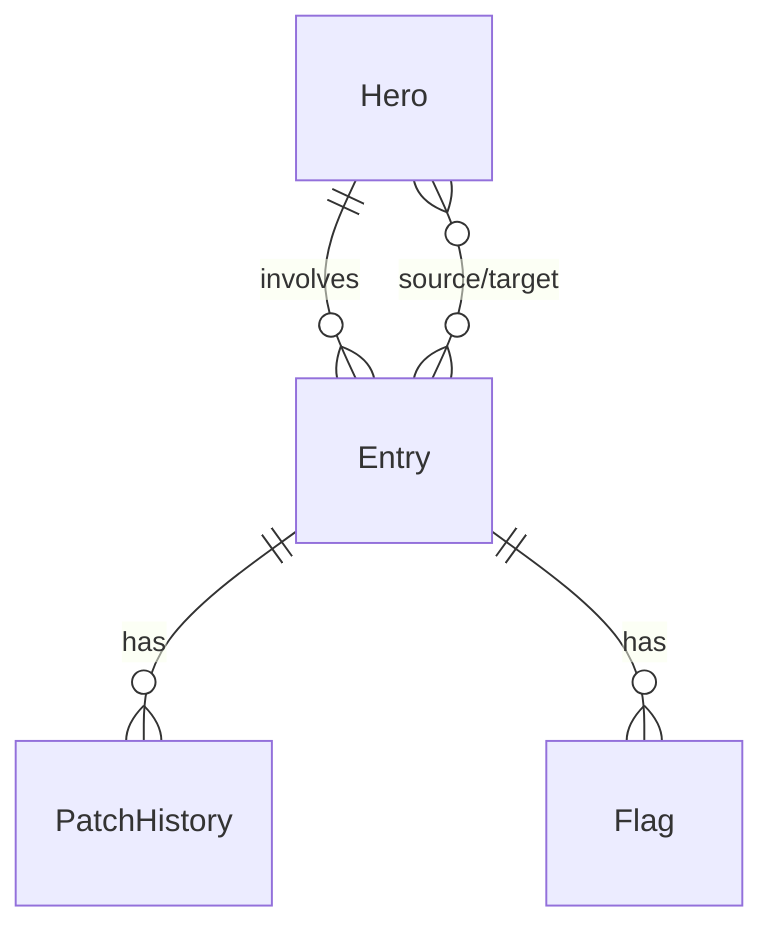

# Architecture Spine: Counterlock

## Design Paradigm

**content-as-code static-first pipeline**, repo content files are SSOT; the build validates, renders static routes, and emits a search index; the only runtime mutation surface is the flag API route. Official artwork ships from a script-synced local asset manifest; no page ever calls the Deadlock Assets API.

| Layer | Directory | Role |
| --- | --- | --- |
| Content (SSOT) | `content/` | heroes, entries, patches, config, edited via git |
| Assets | `public/assets/`, `lib/assets/` | official artwork + generated manifest, written only by the sync script |
| Build logic | `lib/` | zod schema, loaders, search-index builder |
| Routes | `app/` | server components, statically rendered pages |
| UI | `components/` | presentational + client islands |
| Runtime | `app/api/flags/` | only dynamic surface: flag submit/backlog |

```mermaid
flowchart LR
  apiext["Deadlock Assets API"] -->| "only via sync script"| sync["scripts/sync-assets"]
  sync --> pub["public/assets/ + lib/assets/manifest.json"]
  content["content/ SSOT"] --> lib["lib/ schema+loaders+search index"]
  pub --> lib
  lib --> app["app/ routes (RSC, static)"]
  app --> components["components/ UI"]
  app --> api["app/api/flags (dynamic)"]
  api --> kv["Flag KV store"]
```

## Invariants & Rules

### AD-1: Content-as-code SSOT

- **Binds:** FR-1, FR-3, FR-5, FR-6, FR-7, FR-10, FR-11
- **Prevents:** headless CMS / DB content drift; content living outside the repo
- **Rule:** all heroes, entries, patch history, and currentPatch live as structured files under `content/`; no other store holds editorial content.

### AD-2: Content ownership + zod build validation

- **Binds:** FR-11, FR-8, FR-3, FR-5, FR-6
- **Prevents:** malformed entries shipping; silent schema drift; dangling source/target references; divergent file shapes between story-builders
- **Rule:** every content file validates against zod v4 (`zod@^4`) schemas at build; a malformed entry fails the build with a clear error. Required entry fields (vocabulary fixed, not per-story; matches shipped `lib/schema`): `slug`, `kind` (`interaction` | `matchup` | `archetype-warning`), `title`, `sourceRef`, `targetRef`, `effects[]`, `conditions`, `verifiedPatch`, `patchHistory[]` (ordered ascending, may be empty); optional `deprecated` (boolean — drives `badge-deprecated` plus the Deprecated Tech / Patch Note callout, whose patch number and note read from the entry's latest `patchHistory` row, so `deprecated: true` requires a non-empty `patchHistory`, build-enforced; per AD-7). `sourceRef`/`targetRef` are plain kebab slugs that must resolve against the editorial registry (heroes + nested abilities, items, archetypes) or the build fails (referential integrity at build, no runtime resolution). zod owns per-file shape; all cross-file resolution runs exclusively in the `lib/loaders` build pass — one resolution site (AD-17). Entity→directory mapping is fixed: heroes (+ nested `abilities[]`) → `content/heroes/`, entries → `content/entries/`, patch history lives inside entry files, items → `content/items/items.json`, archetypes → `content/archetypes/archetypes.json`, `currentPatch` → `content/config/`.

### AD-3: Flags = only runtime store, owned by API route

- **Binds:** FR-9, FR-12
- **Prevents:** a second runtime store; client-writable persistence; third-party form as primary transport; undefined flag shapes between story-builders
- **Rule:** `/api/flags` owns all flag reads/writes; no other route or client touches the KV store. Flag record shape (fixed): `{ id, entrySlug, verdict: "verified" | "outdated", note?, createdAt, status: "pending" | "reviewed" }`. Routes: `POST /api/flags` body `{ entrySlug, verdict, note? }`, rate-limited, deduped on key `entrySlug + visitorHash` within a rolling window; `GET /api/flags/backlog` returns pending flags as `{ id, entrySlug, verdict, note, createdAt, age }[]`, guarded by `EDITOR_SECRET`; `POST /api/flags/review` body `{ id }`, guarded by `EDITOR_SECRET`, is the **sole** status write path (`pending` → `reviewed`, implemented by the sweep story); `GET /api/flags/overlay` returns `{ flaggedSlugs: string[] }` built from **pending `outdated` verdicts only** (reviewed flags never surface), public read, no secret. Review state lives only in KV (`status`); content files never store flag state.

### AD-4: Static rendering for content routes

- **Binds:** FR-1, FR-3, FR-5, FR-6, FR-7, FR-8, FR-10, FR-2
- **Prevents:** per-request rendering of content; accidental dynamic routes; config/feature-flag drift under Cache Components
- **Rule:** heroes/interactions/matchups/archetypes and home render statically at build via `generateStaticParams` (≥1 param where slugs exist); no route sets `dynamicParams` to per-request behavior. `next.config.mjs` runs `cacheComponents: true` + `partialPrefetching: true` [ADOPTED: scaffold reality]: every static segment must satisfy Cache Components rules (no un-cached dynamic APIs in static segments). Dynamic surface is limited to `/api/flags/*`. Search is not a route, `?q=` on the static home page, read client-side (EXPERIENCE IA).

### AD-5: Client-side search over build index

- **Binds:** FR-2
- **Prevents:** hosted search; server search endpoints; runtime query stores
- **Rule:** a JSON search index is generated at build from `content/` and searched entirely on the client.

### AD-6: RSC-default state

- **Binds:** all FRs (UI)
- **Prevents:** global state libraries; unnecessary client bundles; island-list drift between stories
- **Rule:** components are server components by default; the client-island list is closed: search input/results, flag form, mobile menu, badge-flag overlay fetcher, copy-link button, asset tooltip (WCAG 1.4.13 dismissal, per DESIGN), hero counterpart filter (param pinned to `?vs=`, state serializes to the route query string, mirroring `?q=`, so back-nav preserves browse state per EXPERIENCE). Any other `"use client"` boundary needs a spine update.

### AD-7: Freshness computed at build from currentPatch

- **Binds:** FR-4, FR-8, FR-10
- **Prevents:** runtime freshness computation; per-entry patch logic drift; two owners of badge state; persisted status fields rotting in content
- **Rule:** `currentPatch` is a single content constant; badge **base** state (`verified` | `stale`, from `entry.verifiedPatch` vs `currentPatch`, and `deprecated` from the content boolean, AD-2) is derived at build in `lib/` only, the single owner. Content files never persist derived badge states: `deprecated` (optional boolean) is the only content-held trust signal; `verified`/`stale`/`flagged` never persist anywhere. Runtime flag overlay (`flagged`) is layered separately per AD-12; `lib/` never reads the KV store.

### AD-8: Slug IDs [ADOPTED stack constraint]

- **Binds:** FR-1, FR-3, FR-5, FR-6, FR-7
- **Prevents:** numeric/DB ids; id schemes diverging between content and routes
- **Rule:** content entities use kebab-case slug ids; routes mirror slugs (`/heroes/[slug]`, `/interactions/[slug]`); no numeric ids (no DB).

### AD-9: API JSON envelope + server-side rate-limit/dedupe

- **Binds:** FR-9, FR-12
- **Prevents:** inconsistent API responses; silent failures; spam/duplicate flags
- **Rule:** `/api/flags` responses use `{ok, data?, error?}`; errors never report success; rate-limit and dedupe run server-side in the route handler.

### AD-10: kebab-case [ADOPTED]

- **Binds:** all FRs (naming)
- **Prevents:** naming drift across files, slugs, routes
- **Rule:** files and slugs are kebab-case; components are PascalCase; interface types live in `lib/schema`.

### AD-11: WCAG 2.1 AA [ADOPTED]

- **Binds:** all FRs (UX)
- **Prevents:** accessibility regressions below AA
- **Rule:** all pages and components meet WCAG 2.1 AA; error/empty copy follows EXPERIENCE.md.

### AD-12: Flag overlay read path

- **Binds:** FR-9, FR-4, FR-8
- **Prevents:** ADV-1, static pages unable to show `badge-flagged` while flags stay runtime-only; a second badge-derivation owner
- **Rule:** static pages render the build-time base badge; a client island (in AD-6's closed list) fetches `GET /api/flags/overlay` after hydration and upgrades `verified|stale` → `flagged` for slugs in `flaggedSlugs` (pending `outdated` verdicts only, AD-3). Overlay is read-only and public; it never computes freshness, base state still comes from the build. Failure to fetch leaves the base badge (never blocks render, never falsely claims flagged).

### AD-13: Hero registry is exhaustive

- **Binds:** FR-7
- **Prevents:** ADV-2, roster derived from entries 404ing zero-entry heroes
- **Rule:** `content/heroes/` is the authoritative roster: one file per hero, including heroes with zero entries. Roster and hero pages enumerate the registry, never the entry set. A hero with no entries renders the empty state (FR-7), never a missing route.

### AD-14: Search index single-sourced

- **Binds:** FR-2, FR-10
- **Prevents:** ADV-5/ADV-6, hand-maintained or divergent index; deprecated entries missing from search
- **Rule:** the JSON search index is generated at build by `lib/search` from the same `lib/loaders` output that renders pages, one loader, two consumers (pages + index). The index covers every entry incl. deprecated and embeds the loader-resolved asset metadata (paths, name, type/tier, summary per AD-17) so the client search island never imports the manifest; no separate index schema outside `lib/`.

### AD-15: Design-token delivery

- **Binds:** all FRs (UX), WCAG floor
- **Prevents:** token drift between DESIGN.md and code; component-library creep; light-mode half-work
- **Rule:** DESIGN.md frontmatter tokens ship as CSS custom properties in `app/globals.css` (Tailwind 4 `@theme` mapping); fonts load via `next/font` (Inter, Space Grotesk, JetBrains Mono); no component library, components are hand-built on Tailwind (scaffold constraint). Dark-only: no light-theme tokens until a spine update. Skeletons and `prefers-reduced-motion` behavior follow EXPERIENCE.md.

### AD-16: Asset sync pipeline, offline-from-client

- **Binds:** FR-1, FR-3, FR-7, UX (Official Assets & Media)
- **Prevents:** pages or clients calling the Deadlock Assets API; rate-limit exposure; implicit network dependence of the default build; artwork hand-downloaded outside the pipeline
- **Rule:** `scripts/sync-assets` is the only code that calls `api.deadlock-api.com` (live-verified, no auth): `/v1/assets/heroes`, `/v1/assets/items` (shop items + item-abilities; `item_tier` present on upgrades only), `/v1/assets/items/by-hero-id/<hero id>` (that hero's bound abilities only). It runs manually (`npm run sync:assets`); the default build is network-free — an env-gated pre-sync refresh before build is opt-in and is the only build-time API touch. The script writes images under `public/assets/{heroes,abilities,items}/`, upserts the AD-17 `assetId`/`className` stamps into editorial records (official-name match within scope, git-diff reviewable), and regenerates `lib/assets/manifest.json` — all committed. The manifest validates against the shared zod schema in `lib/schema` (one owner for the sync-writer/build-reader contract): a missing or invalid manifest fails the build with a clear error instead of silently rendering placeholders. Manifest records carry image path + variants (png/webp as offered), a `summary` sentence where the API description provides one, plus per asset family source URL, fetch date, attribution/license note (DESIGN); exact JSON shape beyond that is seed. A valid entity with no image (API gap or missing file) degrades to the DESIGN placeholder (never a broken image, never a runtime fetch). No custom route handler serves assets dynamically (platform image optimizer, if adopted, stays Deferred infrastructure).

### AD-17: Official id / class_name mapping, join owned by loaders

- **Binds:** FR-1, FR-3, FR-7, UX (Official Assets & Media)
- **Prevents:** display-name matching at render; wrong artwork on a card; components importing the manifest; official API ids leaking into routes or slugs (AD-8 conflict); ad hoc tooltip/summary assembly
- **Rule:** editorial records (heroes + nested abilities, items) carry the official API `id` and `class_name` as optional asset-join stamps (`assetId`/`className`), upserted only by the sync script (AD-16) and validated at build: a stamp not found in the manifest fails the build, an unstamped entity simply has no artwork (placeholder path). Kebab slugs remain the primary entity and route id (AD-8 unchanged); entry reference fields keep slugs (AD-10 unchanged). `lib/loaders` owns the single join slug → stamp → manifest entry plus all cross-file resolution (AD-2), and hands typed asset props (paths, name, type/tier, summary; types in `lib/schema`) to components; components never import the manifest, never match by display name, never fetch asset data (one loader, two consumers, like AD-14). Tooltip effect-line precedence is fixed: editorial `summary` field on the record if present, else the manifest description sentence, else name + type/tier only — assembled nowhere else. Tier renders from the manifest `item_tier` per DESIGN (border + the tier stated in words in the tooltip).

```mermaid
flowchart TD
  routes["app/ routes"] --> lib["lib/ schema+loaders+search"]
  routes --> components["components/ UI (asset paths via loader props)"]
  components --> types["lib/schema (types only)"]
  lib --> content["content/ SSOT"]
  lib --> assets
  sync["scripts/sync-assets (only API caller)"] --> assets
  api["app/api/flags/"] --> kv["Flag KV"]
  api --> lib
  routes -.->| "never imports directly"| content
  components -.->| "never imports loaders/content"| lib
  lib -.->| "never reads"| kv
```

## Consistency Conventions

| Concern | Convention |
| --- | --- |
| Naming (files, components, types) | kebab-case files/slugs; PascalCase components; interface types in `lib/schema` |
| Data & formats | slug ids (AD-8); official `id`/`class_name` join fields (AD-17); patch format `X.Y`; dates ISO-8601; API envelope `{ok, data?, error?}`; flag record shape per AD-3 |
| Assets | manifest generated by sync script, never hand-edited, schema-validated (AD-16); `assetId`/`className` stamps upserted by script only; images under `public/assets/`; missing image → DESIGN placeholder (AD-16, AD-17) |
| State & errors | RSC default (AD-6); closed client-island list: search input/results, flag form, mobile menu, badge-flag overlay fetcher, copy-link, asset tooltip, hero counterpart filter; error copy per EXPERIENCE.md; no auth anywhere |

## Stack

| Name | Version |
| --- | --- |
| next | 16.4.6 |
| react | 19.3.0 |
| typescript | ^6.0.3 (TS 7.0.2 exists; project intentionally stays on 6, lockfile reality) |
| tailwindcss | 4.3.3 |
| eslint | ^9 |
| zod | ^4 (current major 4.6.7 at authoring, verify at install) |
| Deadlock Assets API | api.deadlock-api.com, public, no auth (endpoints live-verified 2026-11-16, AD-16) |
| flag KV provider | deferred (Upstash Redis preferred; Vercel KV is sunset/deprecated, do not choose it) |

Scaffold (`app/layout.tsx`, `app/page.tsx`, `app/globals.css`) builds green.

## Structural Seed

```text
counterlock/
  content/ # SSOT: heroes/ (exhaustive registry + nested abilities), items/items.json, archetypes/archetypes.json, entries/, config/ (currentPatch)
  scripts/ # sync-assets: sole Deadlock Assets API caller (AD-16)
  public/assets/ # synced official artwork: heroes/, items/, abilities/ (static-served)
  app/ # routes (RSC, static): page (home+?q=), heroes/, interactions/, matchups/, archetypes/
    api/flags/ # only dynamic surface: POST submit, GET overlay (public), GET backlog (secret)
  components/ # UI + closed client-island list incl. asset tooltip (AD-6)
  lib/ # schema/ (zod v4), loaders/ (asset join, AD-17), search/ (index builder), badges/ (AD-7 owner), assets/ (generated manifest, never hand-edited)
```

**Deployment & environments:** assume Vercel-compatible serverless, route handlers for `/api/flags/*` plus a KV store; content served as static build output; synced assets ship as committed static files (no asset env vars; the public Assets API needs no credentials). Env vars: provider KV connection (e.g. `UPSTASH_REDIS_REST_URL`/`_TOKEN`) and `EDITOR_SECRET` (backlog GET guard); overlay GET needs no secret [ASSUMPTION: host Vercel-compatible].



## Capability → Architecture Map

| Capability / Area | Lives in | Governed by |
| --- | --- | --- |
| FR-1 Hero-first browse | `app/heroes/[slug]` + `lib/loaders` | AD-1, AD-4, AD-8 |
| FR-2 Free-text search | `components/` search island + `lib/search` index | AD-5, AD-6 |
| FR-3 Interaction detail | `app/interactions/[slug]` | AD-1, AD-4, AD-7 |
| FR-4 Freshness signals | badge base computed in `lib/badges` at build; flagged upgrade via overlay island | AD-7, AD-12, AD-2 |
| FR-5 Archetype warnings | `app/archetypes` | AD-1, AD-4 |
| FR-6 Lane matchup guidance | `app/matchups` | AD-1, AD-4 |
| FR-7 Hero roster | `app/heroes` + `content/heroes` (exhaustive registry) | AD-1, AD-8, AD-13 |
| FR-8 Patch Verification Badge | build-time badge derivation in `lib/badges` | AD-7, AD-2, AD-12 |
| FR-9 Community flags | `app/api/flags` POST + flag form island + overlay island | AD-3, AD-9, AD-6, AD-12 |
| FR-10 Patch History / Deprecated | `content/entries` + detail route + search index | AD-1, AD-7, AD-14 |
| FR-11 Curated content authoring | `content/` + build validation | AD-1, AD-2 |
| FR-12 Verification Sweep support | `app/api/flags` GET backlog (secret) + `content/` edits | AD-3, AD-9, AD-7 |
| Official assets (artwork, icons) | `scripts/sync-assets` → `public/assets/` + `lib/assets/manifest.json`; join in `lib/loaders` | AD-16, AD-17, AD-6, AD-11 |

## Deferred

- Flag KV provider. Upstash Redis preferred; Vercel KV sunset (Dec 2024, `@vercel/kv` deprecated), excluded. API contract fixed in AD-3/AD-9; provider only
- Deploy host, assume Vercel-compatible serverless [ASSUMPTION]
- zod version. `zod@^4` required; pin exact at install
- ISR vs pure static, pure static assumed at hobby scale (AD-4)
- Analytics; i18n; image/CDN strategy (incl. `next/image` optimization for `public/assets/`; local static files work unoptimized, AD-16)
- PRD OQ2 (current-patch source) resolved by AD-7 as manual content constant; PRD OQ3 (search scope) resolved by AD-5/AD-14; flag transport preference resolved by AD-3 (API route, not form/Discord); remaining open: provider choice only
